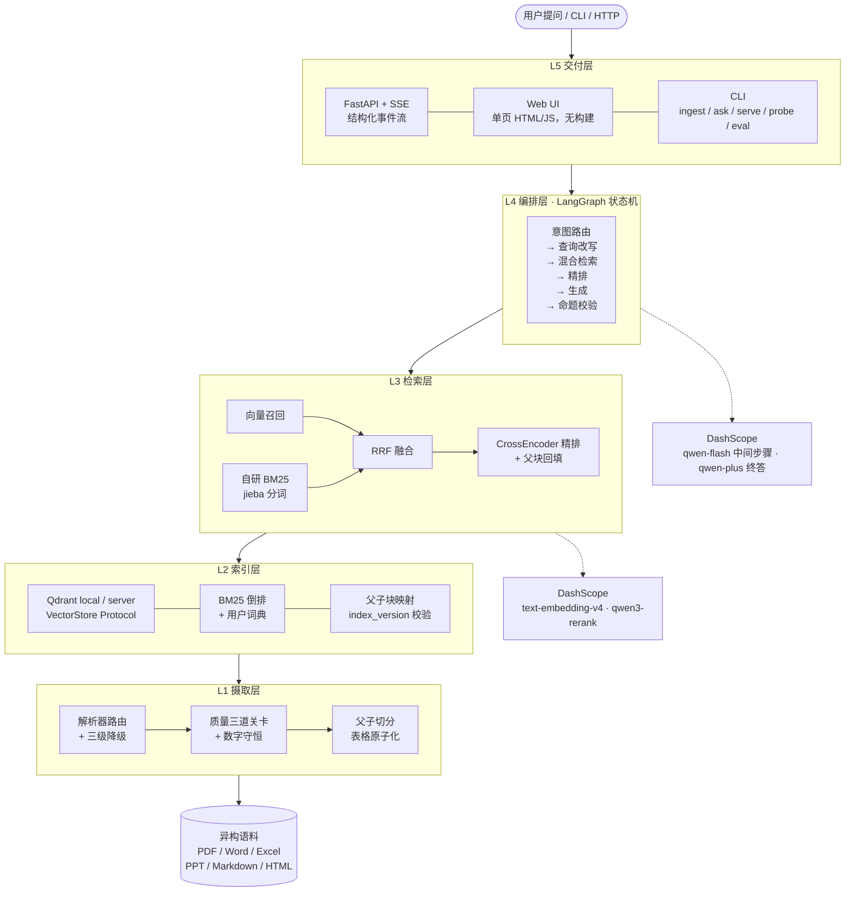
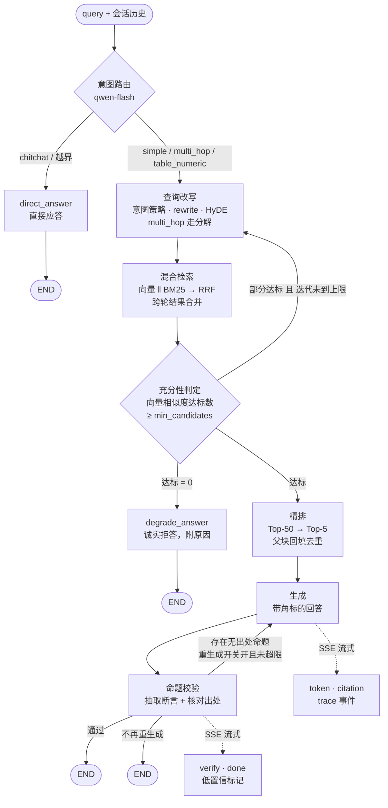

# Agentic RAG · 企业异构文档问答系统

面向企业异构文档（PDF / Word / Excel / PPT / Markdown / HTML）的 RAG 系统：解析器路由 + 父子切分 +
混合检索（向量 ‖ 自研 BM25）+ 自适应路由 + 反思闭环 + 引用溯源，全链路结构化 trace 可观测。

**没有 API Key 也能完整跑通**：内置 Mock 供给，`git clone` 后即可完成解析 → 索引 → 检索 → 编排 → 生成 → UI；
配置真实 Key 后自动切换到 DashScope，不需要改代码。

---

## 核心特性

| 特性 | 实现 |
| --- | --- |
| **异构文档摄取** | 解析器路由 + 三级降级，表格原子化（四档分级不切碎），统一中间表示 |
| **上下文增强切分** | 父子切分（默认）/ 结构感知切分，可配置切换；chunk 注入标题路径块头，展示时回退到原文 |
| **混合检索** | 向量召回 ‖ 自研 BM25（jieba 分词）并行，RRF 融合 |
| **两段式精排** | RRF Top-50 → CrossEncoder 精排 Top-5 → 父块回填去重 |
| **自适应路由** | 意图判定后分流：直接应答 / 简单单跳 / 复杂多跳 / 数值表格；简单问题不进 Agent 循环 |
| **反思闭环** | 检索侧不足则升级改写策略重检（最多 3 轮：意图策略 → `rewrite` → `hyde`，跨轮 RRF 合并），生成侧命题级忠实度校验（可配置重生成），**两条循环各算各的预算** |
| **引用溯源** | 逐句标注来源，可反查文件名、标题路径、页码与原文片段；无出处的命题单独列出 |
| **全链路可观测** | 结构化 trace 驱动 UI 决策轨迹可视化与错误归因，埋点保留宽度 ≥ 上报的最大 K |
| **可复现的评测** | 分层评测集 + 组件级变体矩阵 + 自研指标 + LLM-as-judge，一条命令重跑；**结论数字不随仓库分发** |

---

## 架构

系统分五层，层与层之间用 **Protocol 接口**而不是具体实现耦合：换向量库、换模型供给、换解析后端，
都是换一个实现类，不是改一片代码。



## 一次查询发生了什么



**几个刻意的取舍**：

- **结构化事件而非裸 token**：SSE 推结构化事件（`step` / `token` / `citation` / `reflect` / `verify` / `done`，
  以及缓存命中的 `cache_hit`），UI 因此能画出决策轨迹，而不是只能看到一个在跳的回答。
- **拒答是重判断**：只有"一条相关证据都没有"才拒答；证据不足但非零时照常回答并标 `confidence=medium`。
- **降级必须可见**：检索轮数耗尽、精排失败、向量路关闭，都会在 trace 与事件里留痕，不静默变通。

---

## 技术栈

| 层 | 选型 |
| --- | --- |
| 编排 | LangGraph |
| 模型供给 | 阿里云百炼 DashScope（qwen-plus / qwen-flash / text-embedding-v4 / qwen3-rerank），直连 REST，不用厂商 SDK |
| 文档解析 | PyMuPDF4LLM + MarkItDown（默认），Docling（可选 heavy backend），`PDF_BACKEND=pypdf` 可切换（见下方许可说明） |
| 向量库 | Qdrant（默认 local 模式嵌入式；`qdrant_server` 只改连接配置，代码不分叉） |
| 稀疏检索 | 自研 BM25 + jieba（为每路分数与过滤时机可控、每路可独立开关与调参，边界见 01 §0） |
| 服务 | FastAPI + SSE |
| 前端 | 单页原生 HTML/JS（无构建） |
| 评测 | 自研检索指标 + LLM-as-judge + 变体矩阵 + 配对区间比较 |

选型依据见 [`01-技术选型`](docs/01-技术选型.md)。

---

## 快速开始

```bash
# 1. 安装（Python ≥ 3.11）
pip install -e ".[dev]"
agentic-rag --help                        # 六个子命令：ingest / ask / probe / eval / inspect / serve

# 2. 配置（也可跳过，系统内置 Mock 模型，无 Key 也能跑通全流程）
cp .env.example .env
# 编辑 .env 填入 DASHSCOPE_API_KEY

# 3. 获取语料（语料文件不进仓库，仓库只留清单，见 06 §6.2）
python scripts/fetch_corpus.py            # 按 MANIFEST 下载 + 生成，并校验 sha256
# 只想用自己的文档：把文件放进 data/raw/ 即可，不影响后续步骤

# 4. 构建索引
python -m agentic_rag.cli ingest --input data/raw
# 只想追加新文档：--incremental（按 doc_id 判重，BM25 仍全量重建，见 src/agentic_rag/index/bm25.py）
python -m agentic_rag.cli ingest --input data/raw --incremental

# 5. 命令行问答
python -m agentic_rag.cli ask "文档中关于部署架构的要求是什么？"

# 6. 启动 Web UI
python -m agentic_rag.cli serve
# 浏览器打开 http://127.0.0.1:8000

# 7. 探针校验（重建索引后验证链路连通性，默认已内建在 ingest 里）
python -m agentic_rag.cli probe

# 8. 跑评测（评测集 + A0–A4 / B1–B5 变体，报告落到 eval/results/，不入库）
python -m agentic_rag.cli eval
python -m agentic_rag.cli eval --variants A0,A1,A2
# 真实 API 下先用小样本确认链路：--limit 5；--dry-run 只做本地成本估算，零花费

# 9. 跑测试（无需 API Key，CI 同一步骤）
pytest tests/unit tests/integration --basetemp=.pytest_tmp/ci
```

> 索引构建会按文档量消耗 embedding token。全量摄取前建议先 `--limit` 小样本，并用 `--dry-run` 看估算成本。

---

## 目录结构

```
agentic-rag/
├── docs/                       # 设计文档（01–08）
│   ├── 01-技术选型.md
│   ├── 02-架构设计.md
│   ├── 03-模块设计-离线链路.md
│   ├── 04-模块设计-在线链路.md
│   ├── 05-提示词契约.md
│   ├── 06-语料与评测集.md
│   ├── 07-测试设计.md
│   └── 08-实测基线.md
├── src/agentic_rag/
│   ├── schema.py               # 全局数据结构
│   ├── config.py               # 集中配置 + 启动校验
│   ├── prompts/                # 提示词模板（独立资产管理）
│   ├── providers/              # 模型供给抽象（LLM / Embedding / Rerank + Mock）
│   ├── pipeline.py             # 在线链路唯一入口（server 与 eval 共用）
│   ├── cache/                  # 查询结果缓存（result 级已接线；embedding/rerank 级模块已备、未接线，见 02 §5.4）
│   ├── ingestion/
│   │   ├── quality.py          # 解析质量三道关卡
│   │   ├── router.py           # 解析器路由 + 降级链
│   │   ├── parsers/            # pdf / office / html / 原生文本
│   │   └── chunking/           # structural / parent_child
│   ├── index/
│   │   ├── vector_store.py     # Protocol + Qdrant(local/server) + InMemory
│   │   ├── bm25.py             # 自研 BM25（jieba）
│   │   └── store.py            # 索引门面 + 版本校验
│   ├── retrieval/
│   │   ├── query_transform.py  # 改写 / 分解 / HyDE
│   │   ├── fusion.py           # RRF + 加权融合
│   │   └── retriever.py        # 双路并行召回
│   ├── agent/
│   │   ├── state.py
│   │   ├── nodes/              # 8 个节点
│   │   ├── conditions.py       # 3 个条件边函数
│   │   └── graph.py            # LangGraph 状态机
│   ├── generation/             # 生成 + 引用溯源 + 命题校验
│   ├── observability/trace.py
│   ├── eval/                   # 指标 + judge + 变体 runner + 探针 + 报告
│   ├── server/                 # FastAPI + SSE + 静态前端
│   └── cli.py
├── data/
│   ├── raw/                    # 语料（文件不进仓库，MANIFEST.md 与 sha256 清单进）
│   ├── index/                  # 向量库 + BM25 倒排 + parents.jsonl + chunks.jsonl
│   ├── cache/                  # 缓存落盘目录（当前仅 result 级）
│   ├── user_dict.txt           # jieba 用户词典（脚本生成，进仓库）
│   ├── rejected/               # 解析质量不达标、拒绝入库的文档
│   └── traces/                 # 结构化 trace（JSONL）
├── eval/                       # qa_set.jsonl / probe_set.jsonl（结果目录 eval/results/ 不入库）
└── scripts/                    # 语料构建、词典抽取、变体比较与阈值标定脚本
```

架构设计细节见 [`02-架构设计`](docs/02-架构设计.md)。

---

## 评测

仓库分发的是**可复现的评测能力，不是一份结论表格**。

| 组成 | 位置 | 说明 |
| --- | --- | --- |
| 评测集 | `eval/qa_set.jsonl` | 78 条：单跳 43 / 表格数值 17 / 多跳 10 / unanswerable 8，带三级回退锚点 |
| 探针集 | `eval/probe_set.jsonl` | 20 条链路连通性检查，索引重建后自动跑 |
| 检索指标 | `src/agentic_rag/eval/metrics.py` | Recall@K / MRR / NDCG@K / hit_rate，纯函数、不依赖 LLM |
| 生成指标 | `src/agentic_rag/eval/judge.py` | 命题级忠实度 / 答案相关性 / 引用准确率（LLM-as-judge，失败记 `None` 不填 0） |
| 变体矩阵 | `src/agentic_rag/eval/ablation.py` | A0–A4（组件级）与 B1–B5（策略级），定义见 04 §9.4 |
| 变体比较 | `scripts/pairwise_variant_compare.py` | 只在两个变体都成功的交集上配对，输出 Δ 与 bootstrap 95%CI |
| 阈值标定 | `scripts/calibrate_k1.py` | 用真实向量分布标定充分性阈值，不猜数字 |

**为什么不在仓库里放结论数字**：指标与语料快照、模型版本、embedding 分布强耦合，换时间重跑就不是同一组数；
一份无法复核的指标表，价值不如一条能跑出它的命令。复现方式就是「快速开始」第 8 步，报告写入 `eval/results/`（不入库）。
唯一保留的是可由仓库内脚本**离线复现、零 API 花费**的参数标定（充分性阈值的参考区间见 `scripts/calibrate_k1.py`）——那是配置依据，不是效果结论。

---

## 无 API Key 的运行方式

三个模型供给各有 Mock 实现：`MockLLM` 按提示词里的**字段名**返回合法 JSON；`MockEmbedding` 用字符 3-gram 哈希投影出 1024 维向量（确定性、可复现）；`MockRerank` 按字面重合度打分。
解析、切分、索引、BM25、RRF、编排、SSE、前端全部走生产代码，因此在无 Key 环境下可以验证**链路连通性**与 UI 表现。

**边界必须说清**：Mock 下三路召回高度同构（都是字面匹配），不能据此得出检索或生成质量结论；
`provider_mode` 会写进索引元数据、缓存键与评测报告，Mock 模式下的报告只公布延迟、token、引用完整度这类工程性指标（04 §9.5）。
Mock 是**开发替身**，不是运行期降级目标：API 失败时系统只会回落到规则或诚实应答，不会拿模拟内容冒充答案。

---

## 许可

**代码：MIT**（见 [`LICENSE`](LICENSE)）。

但**默认依赖链中包含 AGPL-3.0 组件**：

| 依赖 | 许可 | 说明 |
| --- | --- | --- |
| `pymupdf4llm` → `PyMuPDF` | **AGPL-3.0** | 默认 PDF 解析路径，速度优势明显 |
| `docling`（可选） | MIT | heavy backend，非默认；`pip install -e ".[heavy]"` |
| `pypdf`（切换项） | BSD | 设置 `PDF_BACKEND=pypdf` 启用，用于规避 AGPL |

AGPL 具有传染性。若要将本项目用于商业闭源场景，请切换 `PDF_BACKEND=pypdf` 或自行获取 PyMuPDF 的商业许可。
把风险写在这里，是希望任何看到这个项目的人都能第一时间知道它。

---

## 演进路线

| 方向 | 触发条件 |
| --- | --- |
| 检索侧小改动提分 | 已定位到代码、纯本地计算：`title_path` 参与 BM25 打分、bigram 短语项、数字 token 保护、父块级分数聚合、`rrf_k` / 融合权重 / `table_boost` 标定 |
| 引用准确率提升 | 生成侧改进：答案模板给带角标示例、生成后做引用一致性校验（可复用 `claim_extract` / `claim_verify`）、无支撑断言降级为不确定表述 |
| 多跳链路优化 | 查询分解与反思是当前瓶颈，优先于检索内核 |
| GraphRAG 实体关系图 | 跨文档关联推理需求上升 |
| 表格结构化检索（NL2SQL） | 数值类问题占比上升 |
| 多模态解析（qwen3-vl-embedding） | 图文混排与扫描件成为主要语料 |
| 在线增量索引 | 语料从静态变为持续更新 |
| 精排候选收缩（Top-50 → Top-20） | 查询量上升，精排成本成为主要支出。实测省约 60% 精排 token，延迟只省 40ms（见 08） |
| 分布式向量检索 | 向量规模破千万（Qdrant local 换 server 只改配置） |
| 人工反馈闭环 | 上线后积累真实查询分布 |

---

## 文档

| 文档 | 内容 |
| --- | --- |
| [01-技术选型](docs/01-技术选型.md) | 每一项的候选对比、决策与依据 |
| [02-架构设计](docs/02-架构设计.md) | 分层架构、状态机、关键机制、数据契约、成本预算 |
| [03-模块设计-离线链路](docs/03-模块设计-离线链路.md) | 配置树、模型供给、解析质量、切分、索引、trace、CLI 的接口契约 |
| [04-模块设计-在线链路](docs/04-模块设计-在线链路.md) | 检索、Agent 编排、生成、评测、服务与前端的接口契约 |
| [05-提示词契约](docs/05-提示词契约.md) | 各提示词模板的输入变量 / 输出 schema / 失败回落（不含模板正文） |
| [06-语料与评测集](docs/06-语料与评测集.md) | 语料来源与格式覆盖、评测集与探针集的构建方法 |
| [07-测试设计](docs/07-测试设计.md) | 单元测试 / 集成测试 / 回归测试的分层与用例清单 |
| [08-实测基线](docs/08-实测基线.md) | 真实 API 的接口契约、延迟与 token 实测 |

CI 在 Python 3.11 / 3.12 上跑单元与集成测试、配置护栏与打包校验，不配置任何 secret —— 测试能在无 Key 的机器上全绿，
是 MockProvider 存在的意义（见 `.github/workflows/ci.yml`）。
