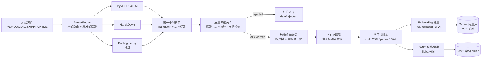
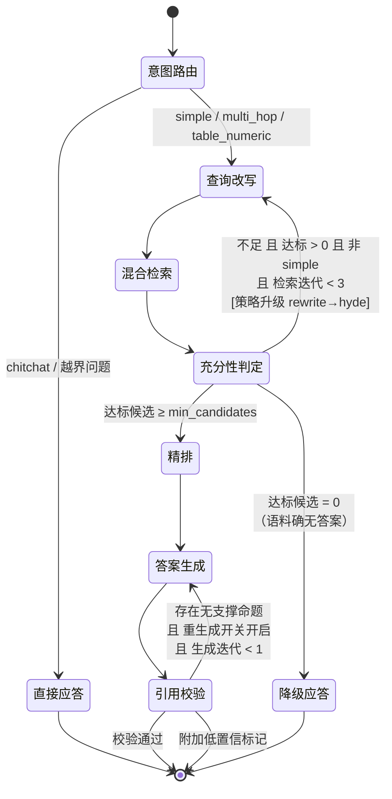
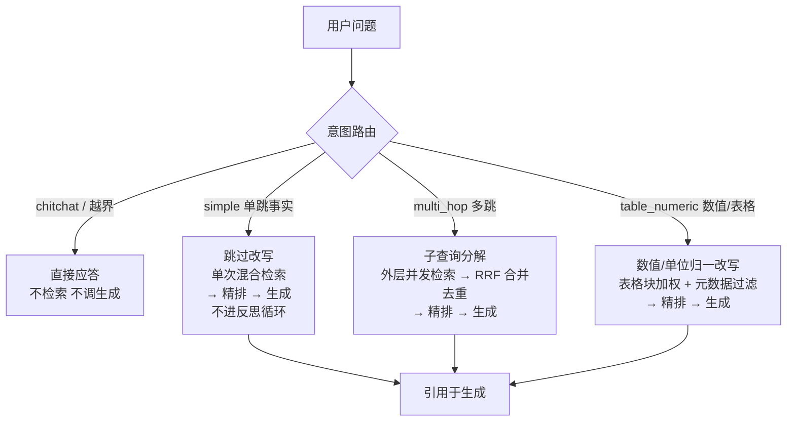

# 架构设计文档

> 配套阅读：`01-技术选型.md`
> 定位：企业级异构文档 Agentic RAG 系统（规模可控但架构完整）

---

## 1. 设计目标与约束

### 目标

1. **准确性**：多跳、含表格、含专有名词的企业文档问答，答案必须可溯源。
2. **可解释**：任何答案都能回答"你是怎么找到它的"。
3. **可测量**：每个组件的收益都有对应指标支撑。
4. **可复现**：`pip install` + 一条命令跑通，无需外部服务。

### 约束

| 约束 | 取值 | 影响 |
| --- | --- | --- |
| 语料规模 | 10² 篇文档 / 10³–10⁴ chunk | 单机内存可承载，不引入分布式 |
| 并发 | 单进程 + 线程池 + 信号量限流（默认 4 路并发） | 图是同步实现，SSE endpoint 必须 async，靠 `run_in_executor` + `asyncio.Queue` 桥接；这是 demo 级取舍，生产需全链路异步化（04§10.4） |
| 成本 | 单次查询 < ¥0.05 | 靠分级模型 + 缓存 + 路由控制 |
| 延迟 | P50 < 3s（非流式到首字） | 并行召回 + 早停 + 条件跳过 |

### 明确不做（Out of Scope）

- 多租户与权限隔离（生产必需，本项不涉及数据隔离场景）
- 分布式向量索引与水平扩容（文档里写明演进路径即可）
- 在线增量索引与删除传播（列为演进项）

---

## 2. 分层架构

系统分为五层，层与层之间通过 **接口（Protocol）** 而非具体实现耦合。

```
┌─────────────────────────────────────────────────────────────┐
│ L5 交付层 FastAPI + SSE · 单页 Web UI · CLI │
│ （流式 token + 结构化事件 + 引用溯源 UI） │
├─────────────────────────────────────────────────────────────┤
│ L4 编排层 LangGraph StateGraph │
│ 路由 → 改写 → 检索 → 精排 → 反思 → 生成 → 校验 │
│ （条件边 · 循环边 · 早停 · 全链路 trace） │
├─────────────────────────────────────────────────────────────┤
│ L3 检索层 混合检索内核（自研） │
│ 向量召回 ‖ BM25 召回 → RRF 融合 → CrossEncoder 精排│
├─────────────────────────────────────────────────────────────┤
│ L2 索引层 VectorStore(Protocol) · BM25Index · 父子块映射 │
├─────────────────────────────────────────────────────────────┤
│ L1 摄取层 ParserRouter → 结构化中间表示 → 切分 → 上下文增强 │
└─────────────────────────────────────────────────────────────┘
        ↕ ↕ ↕
   DashScope LLM DashScope Embedding DashScope Rerank
   (qwen-flash/plus) (text-embedding-v4) (qwen3-rerank)
```

**为什么分层**：每一层都可以单独替换而不影响其他层。例如把 Qdrant 的 local 模式换成 server 部署只改一行配置；把 DashScope 换成其他云只改 L3 上面的 Provider 实现。这个可替换性不是为了炫技，而是**让系统在需求变化时能以最小代价替换实现**——换一个组件改一个实现类，而不是改一片代码。

---

## 3. 离线流水线：文档摄取与索引



### 关键设计点

**3.1 统一中间表示（Canonical Representation）**

解析器输出统一为带结构标注的 Markdown：

```jsonc
{
  "doc_id": "sha1(文件内容)[:16]",
  "blocks": [
    { "type": "heading", "level": 2, "text": "3.2 网络拓扑", "path": ["第三章 部署方案", "3.2 网络拓扑"] },
    { "type": "paragraph", "text": "...", "path": [...] },
    { "type": "table", "text": "| 区域 | 带宽 |...", "path": [...], "atomic": true },
    { "type": "image_caption", "text": "图 3-1 部署架构", "path": [...] }
  ]
}
```

所有解析器差异在这一层被抹平，下游只消费 `blocks`。

**3.2 表格原子化**

`type=table` 的块标记 `atomic=true`，切分时**永不切分**，整体作为一个 chunk。若单表超过 token 上限，则按**行组**切分且每组重复表头（保证列语义不丢失）。

表格大小与子块上限冲突时的分级处置规则见 **03§6.4**（原则：原子性优先于粒度，原子块上限是 `atomic_max_tokens` 而非 `child_chunk_tokens`）。

**3.3 上下文增强块头**

入库文本 = `[文档名 > 一级标题 > 二级标题 > …] + 原文`。成本为零，收益是解决 chunk 脱离文档后的指代丢失。

**3.4 父子块**

- **child（约 256 token）**：用于 embedding 与 BM25 索引，粒度细 → 召回率高、向量语义集中
- **parent（约 1024 token）**：检索命中 child 后，回填其 parent 给生成模型，保证上下文完整
- **parent 不进向量索引**，单独存 `data/index/parents.jsonl`，按 `parent_id` 反查——否则索引体积翻倍

这是 Small-to-Big 检索，解决"小块召回准但上下文不全"的矛盾。

**两个必须写明的代价**：

1. **rerank 的打分对象与生成看到的文本不一致**。rerank 对 child（≤256）打分排序，但送进生成的是 parent（≤1024）。即"精排认为最相关的那段"与"模型实际读到的那段"不是同一段。业界两种做法都有（对 child 排 vs 对 parent 排），本项目选 **对 child 排**——理由是小块语义集中、cross-encoder 在短文本上判别力更强，且排序结果更可解释。代价是生成时上下文里混入了 child 之外的邻近内容，可能稀释相关性。这是可讲的取舍，B3 消融组（父块回填开/关）正好能量化它。
2. **表格块豁免子块上限**。"表格永不切分"与"子块 ≤256"在 256–1024 区间直接打架，已按"原子性优先、上限分级"定死规则（表格按大小分四档处置），详见 03§6.4。

**3.5 解析质量保障（三道关卡）**

解析 100% 无误是做不到的（OCR 会把 `O` 识别成 `0`，跨页表格会断成两半）。因此工程目标不是"无误"，而是**错误可发现、可定位、不扩散**。

| 关卡 | 检查项 | 失败处置 |
| --- | --- | --- |
| 解析前探测 | 文本层探测（判扫描件）、加密损坏、表格密度 | 扫描件 → 切 OCR 通道 |
| 解析中结构校验 | 表格行列一致、标题层级连续、图文关联 | 换解析器重试 |
| 解析后守恒检查 | 数字字符守恒、文本覆盖率、表格还原度 | 超阈值 → **拒绝入库** |

其中**数字字符守恒**性价比最高：对比原文与解析结果的数字字符数，纯字符统计就能抓住"表格没解析出来"这类最严重的错误。

**核心原则：宁可拒绝入库，也不能带病入库。** 解析错误不会让系统报错，只会让答案悄悄变差，且事后无法定位到是哪份文档的哪次解析出了问题。被拒文档进入 `data/rejected/` 并记入摄取报告，等待人工介入。

详见 `03-模块设计-离线链路.md` 第 4 节。

**3.6 幂等与增量**

`doc_id` 由**纯内容哈希**生成（`sha1(文件内容)[:16]`，**不含文件路径**——早期版本在 02 里写"路径+内容"、04 里写"内容"，两处打架，现统一为不含路径）。理由：含路径会让同一份文档换个目录就产生新 `doc_id`，破坏幂等；而不含路径时内容相同的副本会自然合并，这正是想要的语义。

重复摄取同一文件只会 upsert 而不会产生重复 chunk。索引元数据记录 `embedding_model + dim + chunk_strategy` 的**版本号**，版本不匹配时启动阶段直接拒绝加载并提示重建——避免"换了 embedding 却忘了重建索引"导致的静默降质。

**增量摄取的不对称性**：向量库支持增量 upsert，但 **BM25 不支持增量**（IDF 依赖全语料统计），每次增量都会触发倒排全量重建。适用上限约 5 万 chunk（详见 03§7.2）。这是"在线增量索引"被列为 Out of Scope 的真实原因，不能含糊。

---

## 4. 在线流水线：Agent 编排状态机

### 4.1 状态定义

> 与 04§5 保持完全一致。早期版本 02 用 `reflection: str` + `trace: list[TraceEvent]`，05 用 `sufficient: bool` + `tracer: Tracer`，两套 state 打架，现统一到下面这一份。

```python
class AgentState(TypedDict, total=False):
    query: str # 原始问题
    history: list[dict] # 多轮历史（改写做指代消解时需要）
    intent: str # 路由结果：simple | multi_hop | table_numeric | chitchat
    route_reason: str
    route_confidence: float # 路由置信度；与答案级 confidence 分离
    sub_queries: list[str] # 分解/改写后的子查询
    transform_strategy: str # none | rewrite | decompose | hyde
    candidates: list[Candidate] # 混合召回候选（RRF 后）
    sufficient: bool # 由 retrieve_node 判定写入，条件函数只读
    reflect_reason: str # query_expression | corpus_missing
    context: list[ScoredChunk] # 精排 + 去重回填后送生成的上下文
    draft: str # 生成草稿
    citations: list[Citation] # 引用列表
    retrieve_iterations: int # 已完成的检索轮数，自增在 retrieve_node
    generate_iterations: int # 已完成的生成次数，自增在 generate_node
    confidence: str # high | medium | low（答案级，唯一）
    answer: str

    # ── 忠实度校验产物────────────────────────
    claims: list[str] # verify_node 拆出的命题列表
    unsupported: list[int] # 无支撑命题在 claims 中的下标
    faithfulness: float # 1 - len(unsupported)/len(claims)，代码算（05§1.7）
```

**`Tracer` 不放进 state**，用 `config={"configurable": {...}}` 注入。理由：state 要保持纯数据才能配合 checkpoint 回放，而 Tracer 不可序列化。见 04 §5。

### 4.2 状态机



**两条循环各有独立计数器**（共用一个计数器会让检索侧的重试预算吃光生成侧的兜底机会）：

- 检索侧：`retrieve_iterations < 3`（`max_retrieve_iterations`），耗尽 → 带着已有证据进入生成
- 生成侧：`generate_iterations < 2`（`max_generate_iterations`），耗尽 → 低置信标记

**两个计数器的语义都是"该动作已执行几次"，自增写在执行动作的节点里**（`retrieve_node` / `generate_node`），
不写在条件函数里，也不写在"被跳转到的节点"里。后者的后果很具体：重写/生成节点都是首轮必经节点，
在那里自增会让生成侧刚生成完就计数到 1、`1 < 1` 恒假，重生成与 B5 消融全部变成永不执行的死代码。完整论证见 04 §5.1。

**`max_retrieve_iterations` 取 3。** 策略升级共三级，需要两次重检才能走完：
`iteration=0` 用意图策略、`iteration=1` 用 `rewrite`、`iteration≥2` 用 `hyde`。
取 2 时第三次（hyde）永远轮不到——而在 `multi_hop` 下首轮是 `decompose` 不是 `rewrite`，
实际只有一次 rewrite 机会就耗尽预算，测试仍然全绿，而 hyde 分支从不执行。

**预算耗尽不等于拒答。** 只有"达标候选数 = 0"才走 `degrade_answer`；
有证据但不足 `min_candidates` 时照常生成，并在 `confidence` 上如实标 `medium`。
**拒答是比"少证据地回答"更重的判断，它应当要求更强的证据。**

**`simple` 默认不进检索侧循环**（`allow_reflect_for_simple=False`），与 §4.4 路由图一致。生成侧重生成默认也关闭（`regenerate_on_unsupported=False`）——因为流式下 token 已推出，重写一遍的观感很差，默认只标记不重写。两个开关都保留为消融变量。

### 4.3 节点职责

共 **8 个节点**（6 主链路 + 2 终止应答），另有 **3 个条件判定函数**（不是节点，不注册进图）。

| 节点 | 模型 | 职责 | 失败处理 |
| --- | --- | --- | --- |
| **意图路由** | qwen-flash | 判定查询类型，决定走哪条路径与检索参数 | 解析失败 → 默认 simple 路径 |
| **查询改写** | qwen-flash | ① 指代消解（结合历史轮次）② 同义扩展 ③ 多跳分解为子查询 ④ 表格数值问题的单位/指标名归一 | 失败 → 用原 query 直检 |
| **混合检索** | — | 向量与 BM25 并行召回 → RRF 融合 → 取 Top-50；多子查询时外层并发、内层两路并发 | 单路失败 → 用另一路结果继续并标记降级 |
| **精排** | qwen3-rerank | Top-50 → Top-5，父子块回填 | 失败 → 直接用 RRF 结果 |
| **答案生成** | qwen-plus | 流式生成，强制逐句标注引用来源 | 流式中断 → 返回已生成部分 |
| **引用校验** | qwen-flash × 2 | ① 拆原子命题② 逐条判断是否被 context 支持 | 有不支持命题 → **默认只标记**；开关开启且迭代未耗尽才重生成 |
| **直接应答**（终止） | — | chitchat / 越界问题的出口，不检索、不调生成模型 | — |
| **降级应答**（终止） | — | 检索迭代耗尽或语料确无答案时的出口，诚实说"没找到"，**绝不硬编** | — |

| 条件判定函数 | 类型 | 说明 |
| --- | --- | --- |
| `dispatch_by_intent` | 规则 | 按 intent 分流；intent 非法或缺失 → 回落 `simple` |
| `is_sufficient` | 规则（不调 LLM） | 只读 `state.sufficient` / `reflect_strong`（由 retrieve_node 算）；不足且不重试时走生成而非降级 |
| `need_regenerate` | 规则 | 依据 `faithfulness` 与 `regenerate_on_unsupported` 判定（04§6.11） |

**充分性判定是条件边函数，不是节点**：它只做条件路由、不修改状态。全图共 8 个节点（6 主链路 + 2 终止应答）与 3 个条件函数，终止节点 04 §6.8 / §6.9 有完整契约。

**三个条件函数共享三条硬约束**：只读 state、不调 LLM、不推 SSE 事件。
第三条来自一个具体约束：SSE 协议里列了 `event: reflect`，而判定发生在条件函数里，
条件函数拿不到事件队列，这个事件就成了没有发送方的孤儿。现在判定由 `retrieve_node` 完成并推事件。

### 4.4 自适应路由（Adaptive Routing）

**这是整个架构的成本与体验平衡点。**



> `table_numeric` 早期版本在 02 里画成"不改写"、在 05 里却走 `rewrite` 节点，两套不一致。现统一为**走改写**——数值类问题最需要归一化的恰恰是"2025年Q3营收""25年三季度收入"这类表述差异，以及单位与指标别名，这正是改写的用武之地。表格加权与元数据过滤是检索侧的加成，与改写不冲突。

设计依据：**行业经验上生产环境约 60–70% 的查询属于简单单跳**（这是经验值，不是实测；本项目评测集会统计出自己的分布并写进报告，用实测替代借来的数字）。对它们走完整 Agentic 循环是纯浪费。自适应路由让简单问题 1 次检索 + 1 次生成就结束，只有复杂问题才进入多跳/反思路径。这是 Agentic RAG 成本控制的第二手段（第一是分级模型）。

路由结果会写入 trace 并实时推送到 UI，用户能直观看到"系统认为这是个什么问题、因此走了哪条路"。

---

## 5. 关键机制详解

### 5.1 混合检索与 RRF 融合

```
                 ┌── 向量路：query embedding → ANN Top-50 ──┐
用户/子查询 ──┬──┤ ├─→ RRF 融合 → Top-50
              │ └── BM25 路：jieba 分词 → 倒排打分 Top-50 ──┘
              └─（子查询模式下：每个子查询各自走一遍，结果按 RRF 合并去重）
```

**RRF 公式**：`score(d) = Σ_i 1 / (k + rank_i(d))`，`k = 60`

为什么不用加权分数融合：向量相似度 ∈ [0,1]（余弦），BM25 分数无上界且随文档长度分布漂移。两者直接相加等于让量纲大的一方支配排序；归一化又引入对异常值的敏感性。RRF 只使用**排名**，彻底规避量纲问题，且在业界实践中稳定优于加权融合。

**为什么必须要 BM25 这一路**（向量做不到的事）：
- 精确字符串匹配：产品型号 `XR-2400`、错误码 `E0107`、法条编号
- 稀有专有名词：低频术语在向量空间中语义模糊
- 数值与单位：`2025 年 Q3 营收 3.2 亿` 字面命中率远高于语义相似

### 5.2 反思循环（Self-Correction）

两处闭环：

1. **检索侧**（CRAG 思路）：达标候选不足 → 判断是"查询表述问题"还是"语料缺失"。若是前者，按迭代轮次升级改写策略（`rewrite` → `hyde`），重新检索并与上一轮结果 RRF 合并；若是后者（达标数 = 0），直接诚实应答"语料中未找到"，**而不是让模型硬编**。
2. **生成侧**（Self-RAG 思路）：答案生成后拆成原子命题，逐条与 context 比对；存在无支撑命题则**默认只附加低置信标记**，`regenerate_on_unsupported=True` 时才触发重生成。

**循环必须有上限，且两条循环各算各的**：

| 循环 | 计数器 | 上限（= 该动作最多执行几次） | 自增位置 | 耗尽后 |
| --- | --- | --- | --- | --- |
| 检索侧 `retrieve → rewrite` | `retrieve_iterations` | **3** | `retrieve_node` | 带着已有证据进入生成 |
| 生成侧 `verify → generate` | `generate_iterations` | 2（首生成 + 1 次重生成） | `generate_node` | 标 `confidence="medium"` |

早期版本两条循环共用 `state.iterations`，会出现"检索侧重试两次把额度用光、生成侧再无兜底机会"的挤占。理由仍是成本：Agentic RAG 的 token 成本是朴素 RAG 的 3–10 倍，无上限循环会让 P99 成本失控。

**生成侧重生成默认关闭**，理由与流式体验直接相关：token 已经推给用户后再重写一遍，用户会看到答案整体被替换。默认行为是"标记 + 列出无出处命题"，把判断权交给人。这是产品取舍，不是技术限制，并且它本身是一项消融变量。

### 5.3 引用溯源（Citation）

这是本作品对"企业文档场景"最直接的适配：**企业用户不信没有出处的答案**。

- 上下文按 `[1] [2] …` 编号注入，生成时要求**每个事实命题句末标注来源编号**
- `parse_citations` 把 `[n]` 映射为 `Citation` 列表并归一化编号；**无法映射的编号直接丢弃**，不把裸 `[n]` 暴露给用户
- 引用块反查原始文档的：文件名、标题路径、页码/段落序号、原文片段
- UI 侧点击引用 → 展开原文片段并高亮

引用准确率是独立评测维度，单独统计——**答案对不等于引用对**（答案正确但引错了出处，在企业场景里同样不可用），所以 `Citation Accuracy` 与 `Answer Accuracy` 必须分开报，不能合成一个分数。

### 5.4 缓存

| 层级 | 模块 | 缓存对象 | 键 | 收益 |
| --- | --- | --- | --- | --- |
| `result` | `cache/result_cache.py` | 查询结果 | `hash(规范化 query + **history 指纹** + index_version + retrieval_signature + generation_signature)` | 命中直接返回，0 次模型调用 |
| `embedding` | `cache/compute_cache.py` | embedding | `hash(文本 + embedding_model + dim)` | 重复摄取与重复查询省 token |
| `rerank` | `cache/compute_cache.py` | 重排序 | `hash(query + 候选 ID 有序集合 + rerank_model)` | 消融实验重复跑时省成本 |

> **接线状态（如实记录，避免文档与实现不同源）**：当前接入调用链的只有 `result` 级
> （`pipeline.py` 入口处检查命中）；`embedding` / `rerank` 两级的模块已实现，但 providers
> 与消融 runner 均未调用它，属于后续版本项。`CacheConfig.enabled_levels` 默认值因此只含
> `"result"`——配置里保留三个层级名是能力面，不代表三级都已生效。

缓存键必须包含**索引版本号**，否则重建索引后会返回陈旧答案。

命中时的对外行为：result 缓存的命中检查在 pipeline 入口、图执行之前；命中后走 `cache_hit → token（完整答案一条推完）→ citation → done` 的简版事件序列，并写一条 `cache_hit=true` 的简版 trace（协议细节见 04§10.2）。**不逐字重放 token**——用打字机效果伪装成实时生成是欺骗用户。

**命中回放必须带得回分数与命中路由**：缓存只落 `chunk_id` 的话，回放时 `ScoredChunk.score` 与 `hit_routes`
只能重建出来——填 `0.0` 与空列表会让充分性判据的达标计数、UI 的路由标记、评测的 `top_rerank`
拿到"检索到了但分是 0"的假象。因此落盘格式是 `[{"id", "score", "hit_routes"}, ...]`；
**旧格式（纯 id 列表）仍可回放，但分数未知时必须填 `None` 而不是 `0.0`**——`0.0` 是"分是 0"，`None` 才是"不知道"。
`cache_hit` 事件的 `cached_at` 取自落盘的 `_cached_at`（不写就永远是空串）。

**还必须包含检索配置指纹 `retrieval_signature`**（早期版本漏了）。它把一切影响检索结果的配置——`use_bm25` / `use_rerank` / `fusion_strategy` / `rrf_k` / `各 top_k` / `table_boost` / `filter_tables_only` / `chunk_strategy` / `rerank_model` / **`min_candidates` 与 `sufficiency_vector_floor`**——序列化后取哈希。

**result 级还必须再包含生成侧指纹 `generation_signature`。** `retrieval_signature` 只覆盖"召回哪些块"，
管不到"拿到这些块之后怎么变成答案"。缺了它，下面两种改动都会读到**旧答案而不自知**：

- 把 `llm_main` 从 `qwen-plus` 换成 `qwen-max`（或别名静默升级到新模型）→ 缓存仍返回旧模型写的答案
- 改了 `answer` / `verify` 提示词模板 → 缓存仍返回旧模板风格与旧引用格式的答案

第二点尤其致命：模板改动往往是**为了修引用格式或幻觉**，而缓存会把修复前的答案继续喂给用户，
形成一个"改了但没生效"的假象，且极难排查——因为查询结果看起来完全正常。

`generation_signature` = `hash(llm_main + llm_light + temperature/max_tokens + 各 prompt 的 schema_version + max_context_chunks)`。
**prompt 用 `schema_version` 而非正文哈希**：正文每次微调都失效缓存（浪费），而 `schema_version` 只在输出结构变化时递增（05§4 的变更检查清单已强制要求递增），正好对上"缓存是否还安全"的判据。

**result 级还必须包含 `history` 指纹。** `Pipeline.run(query, history)`
里有两个节点消费 history：`route_node`（判断意图时看上下文）与 `rewrite_node`（指代消解必须有历史）。
同一句"它的上限是多少"，在不同上下文里会路由到不同意图、改写成完全不同的查询——
**同一个 query 在不同会话里本就该有不同答案**。而缓存键只看 query，于是：

```
会话 A：问过"单卡额度" → 问"它的上限是多少" → 检索 + 生成 → 写入缓存
会话 B：问过"年费" → 问"它的上限是多少" → 命中 A 的缓存 → 返回年费的上限
```

用户看到的是"答非所问"，而系统日志里一切正常、延迟还特别低。
这类串味故障之所以难查，是因为**它只在多轮会话里出现，单轮回归测试永远测不到**。

```python
def history_fingerprint(history: list[dict] | None, max_turns: int) -> str:
    """只取最近 max_turns 轮，且只取 role/content——不把时间戳等噪声带进键。"""
    if not history:
        return "-"
    turns = history[-max_turns * 2:] # 一轮 = user + assistant
    raw = "\x1f".join(f"{m.get('role','')}:{m.get('content','')}" for m in turns)
    return hashlib.sha1(raw.encode).hexdigest[:12]
```

`max_turns` 取 `cfg.agent.history_max_turns`（默认 3）——**截断长度必须与 `rewrite_node`
实际能看到的历史长度一致**，否则同一个语义上下文会因为缓存键截断位置不同而分裂成多个键。
这是"缓存键"与"提示词契约"之间的一处隐式耦合，05§1.1 与本节都要写这一句。

三级缓存的键由此形成完整链条：embedding 级管模型、rerank 级管模型+候选集、result 级管**全部上游**。
只差最外层这一级，前两级的严谨就白费了。

漏掉它的后果很具体：**UI 的核心卖点是"现场切换消融开关看指标变化"，而切了开关后缓存会继续返回上一个配置算出来的答案**，演示会当场出现自相矛盾的结果。同理，消融实验跑第二组时若命中第一组的缓存，整份报告都是错的——所以 `EvalReport` 也要带上这个指纹做存证。

---

## 6. 数据契约

### Chunk

```python
@dataclass
class Chunk:
    chunk_id: str # {doc_id}:c{seq:04d} 检索单元 | {doc_id}:p{seq:03d} 父块
    doc_id: str
    parent_id: str | None # 子块指向所属父块；父块与 structural 块为 None
    is_parent: bool = False # True = 仅供回填，不进向量与 BM25
    text: str # 含上下文增强块头的入库文本
    raw_text: str # 原文（用于 UI 展示，不含块头）
    title_path: list[str] # 标题路径
    block_type: str # paragraph | table | heading | list
    is_atomic: bool # 表格等不可切分块
    page: int | None
    source: str # 原始文件名
    tokens: int
```

### Citation

```python
@dataclass
class Citation:
    index: int # 正文中的角标序号（与 04§1 一致；02 早期版本漏了此字段）
    chunk_id: str
    source: str
    title_path: list[str]
    page: int | None
    quote: str # 用于 UI 展示的关键句
    score: float # 精排得分，用于置信度展示
```

### TraceEvent

```python
@dataclass
class TraceEvent:
    step: str # route | rewrite | retrieve | fuse | rerank | reflect | generate | verify
    ts: float
    duration_ms: float
    payload: dict # 各步骤的结构化中间产物
    tokens_in: int = 0 # 字段名以 03§3 为准（02 早期版本用 input_tokens/output_tokens）
    tokens_out: int = 0
```

> `step` 枚举以 03§3 为准，**包含 `fuse`**（RRF 融合是独立一步，需要单独计时与记录）；字段名是 `tokens_in` / `tokens_out`。02 与 04 早期各写一套，现统一。

trace 既驱动 UI 决策时间线，也是评测的数据源，一次采集两处消费。

> **埋点宽度是一条锁死后继能力的配置。** `payload` 在各步骤记多少条，由 03§3 的 `trace_keep_top_k` 统一控制（默认 50）。评测要报的最大 K 必须 ≤ 埋点宽度，否则该指标事后算不出来，而 trace 无法补采。

---

## 7. 成本与延迟预算

### 单次查询（simple 路径，无缓存命中）

| 步骤 | LLM 调用 | 原估算 | 实测 |
| --- | --- | --- | --- |
| 意图路由 | qwen-flash × 1 | ~200ms | **412ms**（p50） |
| 查询改写 | 跳过（simple 默认跳过） | — | — |
| 双路并行召回 | 1 次 embedding + 本地 BM25 | ~150ms | **261ms**（embedding 路） |
| RRF 融合 | 本地 | <5ms | <5ms |
| 精排 | qwen3-rerank × 1（50 条） | ~300ms | **294ms** |
| 生成（流式首字） | qwen-plus × 1 | ~800ms | **340ms** |
| 生成（全文，约 160 字） | 同上，流式后半段 | 未估 | **2600ms** |
| 引用校验 ① 命题拆分 | qwen-flash × 1（`claim_extract`） | 未估 | **412ms** |
| 引用校验 ② 支持判定 | qwen-flash × 1（`claim_verify`） | 未估 | **412ms** |
| **合计到首字** | | ≈ 1.5s | **≈ 1.3s** |
| **合计到答案就绪** | | ≈ 1.9s | **≈ 4.7s** |

> 早期版本的成本表漏了"引用校验"这一次 qwen-flash 调用（它在图里是必经节点），补上后是 4 次。

### 单次查询 token 量级（成本约束的分解）

约束是"单次查询 < ¥0.05"。金额依赖厂商实时计价，这里只给**可核对的 token 量级**，金额落地时按控制台单价换算：

| 步骤 | 输入 token 量级 | 输出 token 量级 |
| --- | --- | --- |
| 步骤 | 输入 token 量级 | 输出 token 量级 |
| --- | --- | --- |
| 路由 | ~300（问题 + 意图定义） | ~50 |
| 召回 embedding | ~20 | — |
| 精排 | ~10.6k（实测 10,640，含 query 与候选拼接） | — |
| 生成 | ~4k | ~500 |
| 校验 ① | ~0.6k（答案正文） | ~150 |
| 校验 ② | ~1.5k（命题列表 + 上下文片段） | ~200 |
| **合计** | **≈ 17.1k**（300 + 20 + 10,640 + 4,000 + 600 + 1,500） | **≈ 900**（50 + 500 + 150 + 200） |

**精排是绝对的成本大头**（实测：50 条候选一次吃掉 10,640 token，占单次查询输入量的六成以上）——这直接解释了"语料扩大后先把精排候选从 Top-50 收到 Top-20"这条收缩策略的必要性。

**但收缩到底在省什么，实测后需要说准**（见 `08-实测基线.md` §3.2）：候选从 10 增到 50，延迟只从 242ms 涨到 294ms（+21%），token 却翻了 5 倍。所以**收缩省的是钱（约 60% 精排 token），不是延迟（只省 40ms）**。这个区分有实际用途：当召回不足需要放宽 `fusion_top_k` 时，代价是可预测的——每加 10 条候选约 +2100 token、+15ms，延迟几乎免费，可以放心加。

### 单次查询（multi_hop + 反思循环）

| 项目 | 1 次重检 | 2 次重检（跑满预算） |
| --- | --- | --- |
| 额外检索轮次 | 1 轮（2–4 次 embedding + 2–4 次 BM25） | 2 轮 |
| 改写策略 | `iteration=1` → `rewrite` | 再追加 `iteration=2` → `hyde` |
| 额外 LLM 调用 | **1 次改写** | **2 次改写** |
| 额外延迟 | **≈ 0.67s**（rewrite 412 + retrieve 261） | **≈ 1.34s** |
| **合计到答案就绪** | **≈ 5.4s** | **≈ 6.7s** |
| 单次模型调用数 | **6 次** | **7 次** |

**设计取向**：默认路径追求快，复杂路径追求准，由路由决定走哪条。这正是自适应架构存在的意义，也在评测报告中用 P50/P95 延迟分布体现出来。

---

## 8. 目录结构

```
agentic-rag/
├── docs/
│ ├── 01-技术选型.md
│ ├── 02-架构设计.md
│ ├── 03-模块设计-离线链路.md
│ ├── 04-模块设计-在线链路.md
│ ├── 05-提示词契约.md
│ ├── 06-语料与评测集.md
│ ├── 07-测试设计.md
│ └── 08-实测基线.md
├── src/agentic_rag/
│ ├── schema.py # 全局数据结构
│ ├── config.py # 集中配置 + 启动校验
│ ├── prompts/ # 提示词模板（独立资产管理）
│ ├── providers/ # 模型供给抽象
│ │ ├── llm.py # DashScope / Mock 双实现
│ │ ├── embedding.py
│ │ └── rerank.py
│ ├── pipeline.py # 在线链路唯一入口
│   ├── cache/                     # 查询结果缓存（result 级已接线）
│ │ ├── result_cache.py # 查询结果缓存（键含 index_version + retrieval_signature）
│ │ └── compute_cache.py # embedding / rerank 同构的确定性函数缓存（已实现，未接线）
│ ├── ingestion/ # L1 摄取
│ │ ├── quality.py # 解析质量三道关卡
│ │ ├── router.py # 解析器路由 + 降级链
│ │ ├── parsers/ # pdf / office / html / 原生文本
│ │ └── chunking/ # structural / parent_child（Late Chunking 已移除，见 01 §3）
│ ├── index/ # L2 索引
│ │ ├── vector_store.py # Protocol + Qdrant(local/server) + InMemory
│ │ ├── bm25.py # 自研 BM25
│ │ └── store.py # 索引门面（upsert/持久化/版本校验）
│ ├── retrieval/ # L3 检索
│ │ ├── retriever.py # 混合检索 + RRF
│ │ ├── fusion.py # RRF / 加权融合
│ │ └── query_transform.py # 改写 / 分解 / HyDE
│ ├── agent/ # L4 编排
│ │ ├── state.py
│ │ ├── nodes/ # 8 个节点
│ │ ├── conditions.py # 3 个条件边函数
│ │ └── graph.py # StateGraph 组装 + GraphDeps / NodeContext
│ ├── generation/ # 生成 + 引用
│ │ ├── generator.py
│ │ └── citation.py
│ ├── observability/trace.py
│ ├── eval/ # 评测
│ │ ├── metrics.py
│ │ ├── judge.py # LLM-as-judge
│ │ ├── runner.py # 消融 runner
│ │ ├── probe.py # 探针校验
│ │ └── report.py # EvalReport+ 报告落盘
│ ├── server/ # L5 服务
│ │ ├── app.py # FastAPI + SSE
│ │ └── static/
│ └── cli.py
├── data/raw/ # 语料（含 MANIFEST.md / manifest_detail.json）
├── data/user_dict.txt # jieba 用户词典，脚本生成、产物入库
├── eval/ # qa_set.jsonl / probe_set.jsonl + results/
└── scripts/ # fetch_corpus / make_* / build_user_dict / corpus_manifest
```

---

## 9. 分阶段落地计划

| 阶段 | 内容 | 产出 |
| --- | --- | --- |
| P0 | 配置 + Provider 抽象 + Mock 实现 | 无 key 即可跑通骨架 |
| P1 | 摄取（解析器路由 + 质量三关 + 切分 + 上下文增强） | 异构文档 → 结构化 blocks |
| P2 | 索引（Qdrant local + 自研 BM25）+ 最小临时探针 + **mini 评测集 20–25 条** | 持久化索引 + 版本校验 + 链路自检 |
| P3 | 检索（混合 + RRF + 精排）+ **检索指标与 trace 埋点** + **标定 `sufficiency_vector_floor`** | CLI 可查询 + 可算 recall@K / MRR + **阈值标定结果写进 EvalReport** |
| P4 | 编排（LangGraph 自适应路由 + 反思） | 完整 Agent 链路 + trace |
| P5 | 生成与引用 + **生成侧 judge、消融 runner，用 mini 集首跑 A0–A4** | 带溯源标记的答案 + 第一轮消融结论 |
| P6 | FastAPI + SSE + Web UI | 可视化决策时间线 |
| P7 | 评测报告生成 + Mock 降级路径 + 多轮稳定性 | 完整实验台 |
| P8 | **mini 集扩充至 60–100 条 + 探针集 20 条 + 人工复核 → 复跑消融 → 出报告** | 可对外引用的数字 |

**关于评测为什么不再整体推到最后**：早期版本把评测集与评测框架都排在 P7–P8，但这是把三件性质不同的事打包了——标注数据的规模、评测指标代码、消融实验首跑。前一件可以晚（数据会随切分调整而返工），**后两件必须早**：

- **trace 埋点**写在生产代码里，不是评测代码。若 P8 才想起来要算 MRR，会发现历史跑次没记录 rerank 前后排名，只能全量重跑、重新花钱调 API。
- **消融首次运行**必须发生在架构还能改的时候。A0–A4 是本项目最核心的说服点，若 P8 才第一次跑出"rerank 收益不显著"，此时代码已冻结，唯一能做的只是把它写进报告当结论——这是先射箭后画靶。

因此 mini 集在 P2 建（20–25 条，1.5 小时量级），P5 用它首跑消融，P8 只做扩充与复核。详见 `06-语料与评测集.md` §7。

**关于 P2 的"最小临时探针"**：03§10 规定建索引后自动跑探针，但正式探针集要等 P8 才建，中间这段是空的。因此 P2 阶段先手写 **3–5 条临时探针**（每条只标"来源文件名 + 一句话答案"），只验证链路通不通。它与 mini 评测集并存——探针保"没坏"，mini 集保"变好了"。

**关于两件同名不同质的事**：上表分批构建的是**评测数据集**（`qa_set` / `probe_set` 的标注数据）；而 `07-测试设计.md` 里的 pytest 单元测试与集成测试**不推迟**，随 P0–P7 各阶段同步编写。前者是给模型打分的数据，后者是给代码打分的数据，不要混为一谈。

---

## 10. 演进路线

| 方向 | 说明 | 触发条件 |
| --- | --- | --- |
| **GraphRAG** | 从文档抽取实体关系图，用于跨文档关联推理 | 语料中实体关联密集、多跳问题占比高 |
| **结构化检索** | 表格/Excel 转 DataFrame，用 NL2SQL 做数值问答 | 数值类问题占比上升 |
| **多模态** | `qwen3-vl-embedding` 处理图文混排与扫描件 | 图片信息承载关键内容时 |
| **在线增量索引** | 文档变更 → 增量 upsert + 删除传播 | 语料从静态变为持续更新 |
| **精排候选收缩** | `fusion_top_k` 由 50 降到 20（省约 60% 精排 token，延迟只省 40ms） | 查询量上升使精排成本占比成为主要支出；§7 与 §5.4 均引用本行 |
| **向量库换部署形态** | Qdrant local → Qdrant server（只改 `url` / `api_key`，代码不分叉） | 需要多进程访问索引或独立扩容 |
| **分布式检索** | Qdrant → Milvus 集群 | 向量规模破千万 |
| **人工反馈闭环** | 用户点赞/点踩 → 回流为评测集与 few-shot 样本 | 上线后积累真实分布 |

---

## 11. 本架构的三个设计主张

1. **编排与基础设施用框架 / 库，检索打分口径自研。** 控制流的表达交给 LangGraph，解析、分词、向量库一律用成熟库；
   自己写的只有**打分与融合的口径**——领域词典注入、表格块加权、过滤下推、逐路消融，四件事都要求对口径逐项控制。
   这不是"自己写更厉害"：BM25 与 RRF 都是标准算法，实现它们不产生技术增量，两块合计约 230 行、占全量约 2%。
   **规模上升到百万级时应换 Elasticsearch / OpenSearch，而不是继续优化自研实现**（完整判据见 01 §0"自研边界"）。
2. **Agent 的价值在于"不该用时不滥用"。** 自适应路由决定何时跳过 Agent 循环，这比无脑多跳更接近生产现实，也更能讲清成本意识。
3. **没有评测就不算完成。** 每个组件都有对应的消融实验指标，用数据回答"这么做值不值"。
